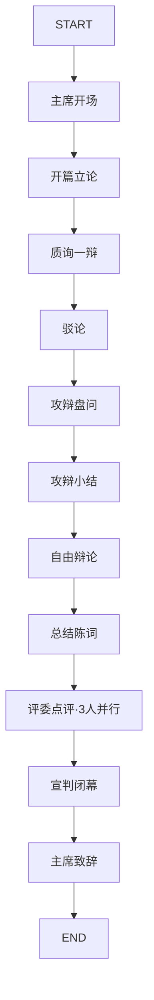

# 多 Agent 对抗辩论模拟系统 · 全栈技术架构文档

| 文档信息 | 内容 |
|---|---|
| 项目名称 | Multi-Agent Debate（多 Agent 对抗辩论模拟平台） |
| 文档版本 | v2.0（全栈版；v1.0 为纯引擎架构，本文覆盖之） |
| 撰写日期 | 2026-10-24 |
| 关联文档 | [PRD.md](PRD.md)（角色设定、赛制流程、评分体系以 PRD 为准） |
| 文档状态 | 待评审 |

**形态说明**：本项目是完整全栈 Web 平台——用户在网页上注册登录、从辩题库选辩题发起比赛，LangGraph 辩论引擎在后端执行，13 环节赛况通过 SSE 实时直播到前端，赛后归档入库并可导出 Markdown / HTML 报告。

---

## 1. 技术栈总览（已确认，共 12 项决策）

| 层面 | 选型 | 说明 |
|---|---|---|
| 引擎运行时 | **Python ≥ 3.11** | asyncio 驱动引擎与并发评委 |
| 多 Agent 编排 | **LangGraph** `StateGraph` | 环节级状态图（§5） |
| LLM 接入 | **OpenAI 兼容协议**（`openai` SDK + 自定义 `base_url`） | 兼容智谱 GLM / DeepSeek / Kimi / OpenAI 等，换模型只改配置 |
| 后端 API | **FastAPI** | 异步原生、自动 OpenAPI 文档、原生 SSE 支持 |
| ORM | **SQLModel** | Pydantic 模型与表模型一体，与 FastAPI 类型贯通；底层 SQLAlchemy，迁移用 Alembic |
| 数据库 | **MySQL 8**（utf8mb4） | 用户指定；驱动 `asyncmy`，异步引擎 |
| 前端框架 | **React 18 + Vite + TypeScript** | SPA，不引入 SSR（后端已有 FastAPI） |
| UI 组件库 | **Ant Design 5** | 表格/表单/布局现成；评分雷达图用内联 SVG 自绘（v2.1 修订：省去 @ant-design/charts 重依赖，与 HTML 报告同源口径） |
| 前端数据层 | TanStack Query + zustand + axios | 服务端状态缓存 + 直播态本地 store |
| 实时通信 | **SSE** | 单向直播流，自动重连；HTTP 原生（§8.3） |
| 认证 | **完整注册登录**，JWT + bcrypt，httpOnly Cookie | 多用户，比赛归档按用户隔离（§9） |
| 部署 | **本地开发 + Docker Compose 交付** | 开发：uv + Vite dev；交付：backend + mysql + nginx 三容器 |
| 输出导出 | **Markdown + HTML 报告** | 由 Web 主形态降级为"赛后导出"功能（§11） |

---

## 2. 系统架构总览

```
┌────────────────────────────────────────────────────────────────┐
│                     前端 SPA（React + Vite + AntD）              │
│   登录/注册 │ 辩题库 │ 发起比赛 │ 辩场直播(SSE) │ 历史归档         │
└───────────────┬────────────────────────────────────────────────┘
                │  REST(JSON)              │ SSE(EventSource, Cookie 鉴权)
                ▼                          ▼
┌────────────────────────────────────────────────────────────────┐
│                       FastAPI 后端                              │
│  api/auth.py   api/topics.py   api/debates.py   api/sse.py     │
│        │                                       ▲               │
│        ▼                                       │ 事件           │
│  ┌───────────────┐   每条发言实时落库+发布   ┌────────────────┐  │
│  │ services/     │ ──────────────────────▶ │ services/      │  │
│  │ debate_runner │        DB + EventBus    │ event_bus      │  │
│  └──────┬────────┘                         └────────────────┘  │
│         ▼ 托管 asyncio 任务                                     │
│  ┌────────────────────────────────────────────────────────┐    │
│  │            LangGraph 辩论引擎（engine/）                 │    │
│  │  13 环节状态图 · Agent 上下文组装 · 计时/打断/摘要模拟     │    │
│  └──────┬─────────────────────────────────────────────────┘    │
└─────────┼──────────────────────────────────────────────────────┘
          ▼                                    ▼
┌──────────────────────┐          ┌──────────────────────────────┐
│  LLM 网关(OpenAI 兼容) │          │  MySQL 8（utf8mb4 + Alembic） │
│  GLM/DeepSeek/Kimi/…  │          │  users·topics·debates·        │
│  重试·超时·分档温度     │          │  speeches·scorecards          │
└──────────────────────┘          └──────────────────────────────┘
          赛后导出：render/ → transcript.md / scorecard.md / report.html
```

---

## 3. 核心设计决策（ADR 摘要）

### 3.1 引擎层决策（v1.0 继承，仍然有效）

| # | 决策 | 理由 |
|---|---|---|
| D1 | **图节点 = 环节，而非每次发言**；环节内对话往返（质询、自由辩）用节点函数内命令式循环 | 50+ 节点的图不可维护；辩论是"固定环节顺序 + 环节内可变轮次"两层结构。辩论"打断"是辩术概念，不用 LangGraph `interrupt`（那是人工审批机制） |
| D2 | **计时员是确定性代码**：时长 = 分钟 × 语速（默认 220 字/分钟）换算成字数预算，耗尽即截断 | 计时归 LLM 不可靠；纯代码 100% 确定零成本 |
| D3 | **上下文分层注入**：角色 Prompt + 辩题立场 + 滚动战局摘要 digest + 最近 6 条原文 + 本环节任务指令 | 全量实录数万 token，会爆 |
| D4 | **评委打分 JSON 结构化输出** + Pydantic 校验，失败重试 | 评分需程序化汇总 |
| D5 | **评委 3 人并行**（asyncio.gather），辩手全程顺序 | 发言互斥必须顺序；评委独立可并行 |
| D6 | **模型分档**：辩手用主力模型（温度 0.85），主席/评委/摘要用廉价模型（温度 0.2~0.3） | 降本，且流程性工作不需创造力 |

### 3.2 全栈层新增决策

| # | 决策 | 理由 |
|---|---|---|
| A1 | **引擎作为后台 asyncio 任务**（`asyncio.create_task`）跑在 FastAPI 进程内，每条发言**先落库、再发布事件**到进程内 EventBus，SSE 订阅者各自消费 | 单实例部署下最简架构；DB 是唯一事实来源，SSE 只是推送通道，断线可从 REST 补齐 |
| A2 | **SSE 断线续传**：事件带单调递增 `id`，前端重连时带 `Last-Event-ID`，服务端从 `speeches` 表按 `seq` 重放缺口 | 浏览器自动重连场景下不丢发言 |
| A3 | **认证用 httpOnly Cookie 承载 JWT**，而非 localStorage/Authorization 头 | 原生 `EventSource` 无法自定义请求头，Cookie 随请求自动携带，SSE 鉴权零特殊处理 |
| A4 | **Markdown/HTML 从主输出降级为导出功能** | Web 主形态下，实录与评分的载体是 DB + 前端页面；导出保留给存档分享场景，复用 v1.0 渲染层 |
| A5 | **每用户资源护栏**：并发进行中比赛 ≤ 1 场、每日场次配额（可配） | 一场比赛 = 数十次 LLM 调用，必须防滥用烧钱 |
| A6 | **引擎保留 CLI 直跑模式**（`python -m debate run`） | 无 Web 环境下调试引擎、跑批量实验不受 API 层牵制 |

---

## 4. 数据库设计（MySQL 8）

> 全部表 `utf8mb4`；主键 `id` 为自增 BIGINT；时间字段 `DATETIME`。

| 表 | 关键字段 | 说明 |
|---|---|---|
| `users` | username（唯一）、password_hash（bcrypt）、created_at | 注册用户 |
| `topics` | owner_id（NULL=系统内置辩题）、title、pro_points、con_points、is_builtin、created_at | 辩题 + 双方破题要点（PRD §7） |
| `debates` | topic_id、owner_id、format(full/lite)、status、cfg_json（赛制参数/模型分档/评委数）、winner、team_total_pro、team_total_con、usage_json（token 用量）、error、started_at、finished_at | status ∈ pending / running / finished / failed / stopped |
| `speeches` | debate_id、seq（场内单调递增，UNIQUE(debate_id, seq)）、phase、phase_name、speaker_role、camp、text、side_notes_json（计时/打断/违规旁注）、interrupted、word_count、tokens、created_at | 实录最小单元；SSE 续传按 seq 重放 |
| `scorecards` | debate_id、judge、focus、scores_json（六维分，PRD §5.1）、vote、highlights_json、weaknesses_json | 每评委一行 |

归属与可见性：debates / 自建 topics 按 `owner_id` 隔离，仅创建者可见（内置辩题全员可读）。

---

## 5. LangGraph 引擎设计（内嵌于后端 `engine/`）

### 5.1 图拓扑（完整版 11 节点；lite 裁剪为 8 节点，但主席开场/致辞两端必留）



- full / lite 两套挂载由 `graph/builder.py` 构建（lite：主席开场→立论→驳论→自由辩→总结→点评→宣判→主席致辞）。
  v2.2 修订：lite 此前漏挂 `opening`，主席引题演讲永不产生（前端立论框架常年空白）。
- 环节内循环伪代码、`DebateState`、自由辩分别计时逻辑与 v1.0 相同：状态含 `transcript / phase_index / clock / digest / scorecards / verdict`。

### 5.2 Agent 与 Prompt 资产

- 角色不硬编码：`roles/*.md`（13 个位）+ `rules/conduct.md`（六条守则）+ `topics/*.md`（辩题与破题要点）作为 **Prompt 源**由 `agents/loader.py` 启动时加载。
- 每次辩手调用的上下文五段式见 D3；四辩总结与评委点评额外注入全场要点清单，防复盘漏战场。

### 5.3 引擎 → 平台的事件对接

引擎在以下时机回调 `DebateRunner` 提供的两个钩子（引擎自身不感知 Web）：

```python
on_speech(speech: Speech)      # 落库 speeches + EventBus.publish + 推进 seq
on_event(evt: PlatformEvent)   # phase_start / timer / interrupt / phase_end / verdict / status
```

计时提醒（剩 30 秒/时间到）、打断标记解析与守则限制（有理由、至多 2 次）、违规检测均为确定性代码（`sim/`），产出 `side_notes` 一并落库。

---

## 6. 引擎内部数据结构（engine/schema.py）

```python
class Speech(BaseModel):        # 对应 DB speeches 行
    seq: int; phase: int; speaker: str; camp: Camp
    text: str; side_notes: list[str] = []; interrupted: bool = False
    word_count: int; tokens: int = 0

class ScoreCard(BaseModel):     # 评委结构化输出（D4）
    judge: str; focus: str
    scores: dict[Camp, dict[str, int]]      # 六维（PRD §5.1）
    vote: Camp
    highlights: dict[Camp, list[str]]       # 双方各 2~3 条，须引原话
    weaknesses: dict[Camp, list[str]]

class Verdict(BaseModel):
    votes: dict[Camp, int]; team_totals: dict[Camp, int]
    winner: Camp | None                     # 平票→总分→最佳辩手所在队（PRD §5.2）
```

---

## 7. LLM 网关（engine/llm/gateway.py）

- `openai.OpenAI(base_url, api_key)` → `chat.completions`；`MODEL_DEBATER`（辩手主力）与 `MODEL_OFFICIAL`（评委/主席/摘要，廉价）在 `.env` 分档。
- 超时 60s；指数退避重试 3 次；耗尽则该次发言降级为"[系统] 该辩手超时未发言"旁注，流程不中断。
- 逐调用记录 tokens，赛后汇总进 `debates.usage_json` 并展示在评分表末尾。
- 评委评分 JSON 解析失败重试 2 次，仍失败该评委按弃权处理并在报告标注。

---

## 8. API 设计（FastAPI）

### 8.1 认证（httpOnly Cookie，A3）

| 端点 | 说明 |
|---|---|
| `POST /api/auth/register` | 用户名 + 密码（bcrypt） |
| `POST /api/auth/login` | 校验后 `Set-Cookie: access_token`（httpOnly） |
| `POST /api/auth/logout` / `GET /api/auth/me` | 登出 / 当前用户 |

### 8.2 业务 REST

| 端点 | 说明 |
|---|---|
| `GET/POST /api/topics`、`DELETE /api/topics/{id}` | 辩题库：内置 + 自建（隔离） |
| `POST /api/debates` | 入参：topic_id 或自定义辩题、format、judges 数；校验 A5 配额后创建并启动引擎任务 |
| `GET /api/debates?status=` / `GET /api/debates/{id}` | 我的比赛列表 / 详情（含 verdict 与用量） |
| `GET /api/debates/{id}/speeches?after_seq=N` | 历史发言增量拉取（断线补齐、归档翻页） |
| `POST /api/debates/{id}/stop` | 协作式取消引擎任务，status → stopped |
| `GET /api/debates/{id}/export?format=md\|html` | 赛后导出（A4） |

### 8.3 SSE 直播端点

`GET /api/debates/{id}/stream`（EventSource，Cookie 鉴权）

| 事件 | data 载荷 |
|---|---|
| `phase_start` | `{phase, name, actors, duration}` |
| `speech` | `{seq, speaker, role, camp, text, interrupted, side_notes}` |
| `timer` | `{type: "warning" \| "time_up", speaker}` |
| `interrupt` | `{by, reason, seq, text, side_notes, word_count}`（P1-1：`seq`+`text` 为被打断发言的截断后终稿，前端就地修正已渲染内容） |
| `phase_end` | `{phase}` |
| `judging` | `{judges: [...]}`（评委点评中） |
| `verdict` | `{votes, team_totals, winner, scorecards}` |
| `status` | `{status}`（running/finished/failed/stopped） |
| `error` | `{message}` |

每个事件带 `id: <单调递增>`；断线重连按 `Last-Event-ID` 从 DB 重放缺口（A2）。反向代理需关闭缓冲（nginx `X-Accel-Buffering: off`）。

---

## 9. 认证与权限

- 密码 bcrypt 哈希；JWT 放 httpOnly Cookie；受保护路由经 FastAPI 依赖注入 `get_current_user`。
- 归属校验：debates / 自建 topics 的所有读写先校验 `owner_id == current_user.id`（内置 topics 除外）。
- 资源护栏（A5）：并发 1 场（超限 429）；每日场次不限（v1.3 修订）。
- 预留角色扩展位（`users.role` 字段），v1 只实现普通用户。

---

## 10. 代码工程结构

```
Multi-Agent Debate/
├── PRD.md / ARCHITECTURE.md
├── docker-compose.yml          # backend + mysql + frontend(nginx) 三服务
├── backend/
│   ├── pyproject.toml          # uv 管理依赖
│   ├── .env.example            # OPENAI_API_KEY / OPENAI_BASE_URL / MODEL_DEBATER / MODEL_OFFICIAL / MYSQL_URL / JWT_SECRET
│   ├── config.yaml             # 赛制时长、语速、温度分档、配额
│   ├── alembic/                # 数据库迁移
│   ├── rules/  roles/  topics/ # 文档资产 = Prompt 源（人读与机读合一）
│   ├── src/debate/
│   │   ├── __main__.py         # CLI 直跑模式（A6）
│   │   ├── core/               # config.py  security.py(JWT/bcrypt)
│   │   ├── db/                 # models.py(SQLModel)  session.py
│   │   ├── api/                # auth.py  topics.py  debates.py  sse.py  deps.py
│   │   ├── services/           # debate_runner.py(任务生命周期)  event_bus.py
│   │   ├── engine/             # LangGraph 引擎（v1.0 架构原样内嵌）
│   │   │   ├── graph/          # state.py  builder.py(full/lite 裁剪)
│   │   │   ├── nodes/          # phases.py  officials.py  judges.py
│   │   │   ├── agents/         # loader.py  context.py
│   │   │   ├── rag/            # corpus.py  retriever.py  websearch.py（v1.4 + v1.4.1）
│   │   ├── tools/           # elenchus.py（v1.6：论证分析，inproc + MCP stdio 客户端）
│   │   ├── sim/            # timer.py  interrupt.py  digest.py
│   │   │   ├── llm/gateway.py
│   │   │   ├── schema.py       # §6 数据结构
│   │   │   └── render/         # markdown.py  html.py（导出用，A4）
│   │   └── templates/report.html.j2
│   └── tests/                  # pytest：FakeLLM 脚本化响应
└── frontend/
    ├── package.json            # Vite + React 18 + TS + AntD 5
    └── src/
        ├── api/                # axios 客户端 + useDebateStream(EventSource hook)
        ├── stores/             # zustand：直播态（发言流、计时、当前环节）
        ├── pages/              # Login/Register · TopicLibrary · Arena · Archive
        └── components/         # SpeechCard · PhaseTimeline · TimerBar ·
                                # InterruptBadge · ScoreBoard(雷达图) · VerdictBanner
```

---

## 11. 前端页面设计

| 页面 | 内容 |
|---|---|
| 登录 / 注册 | 用户名密码；登录后跳转辩题库 |
| 辩题库 | 内置辩题卡片 + 自建辩题 CRUD（标题、正反破题要点编辑）；"发起比赛"入口 |
| **辩场直播页（核心）** | 顶部环节时间线（13 环节点亮进度）；发言流按角色卡片渲染，配色：正方蓝 / 反方红 / 主席灰 / 计时黄 / 评委金；发言卡内嵌旁注徽标（剩 30 秒、打断、违规）；当前发言者计时条实时走字数预算；评委点评阶段三张评分卡并行浮现；结束后顶部胜方横幅 + 六维评分雷达图 + 团体总分 |
| 历史归档 | 我的比赛列表（状态/胜方/时间）→ 点进回看完整实录与评分；导出 md / html 按钮 |

前端状态策略：列表与详情走 TanStack Query 缓存；直播页发言流走 zustand 本地 store 由 SSE 增量追加；页面刷新时先 `GET speeches?after_seq=0` 补齐再续订 SSE。

---

## 12. 部署与运行

| 模式 | 命令 | 组成 |
|---|---|---|
| 本地开发 | `uv run uvicorn debate.api:app --reload` + `npm run dev` + 本地 MySQL | 前后端热更新，Vite 代理 `/api` |
| Docker Compose 交付 | `docker compose up -d` | `backend`（uvicorn）+ `mysql:8`（volume 持久化）+ `frontend`（构建产物由 nginx 托管并反代 `/api`、关闭 SSE 缓冲） |
| CLI 直跑 | `python -m debate run --topic 1 --format lite` | 不起 Web，直跑引擎出文件（A6） |

---

## 13. 错误处理与可观测性

1. LLM 失败：重试 → 降级占位发言 → 流程继续（§7）。
2. 引擎任务崩溃：`debates.status=failed` + `error` 字段落库，前端归档页可见错误详情；v2 可升级独立任务队列。
3. SSE 断连：浏览器自动重连 + `Last-Event-ID` 重放（A2），页面刷新走 REST 补齐。
4. 守则违规：代码侧检测写入 `side_notes`，评委与报告引用。
5. 日志：后端结构化日志（环节进出、每次调用 tokens/耗时）；导出报告末尾附用量小结。

---

## 14. 测试策略

| 层级 | 工具与内容 |
|---|---|
| 引擎单测（无 LLM） | pytest + FakeLLM 脚本化响应：图裁剪、计时预算与 30 秒提醒点、打断规则、评分汇总与平票规则、digest 更新 |
| 后端接口测试 | pytest + httpx ASGI：注册登录鉴权、归属隔离、SSE 事件序列与 Last-Event-ID 续传、配额拦截 |
| 前端测试 | Vitest + Testing Library：直播页 SSE 事件渲染、断线重连补齐逻辑 |
| 集成冒烟 | lite 赛制 + 廉价模型真跑一场 |
| 验收 | PRD §10 九条标准逐条核对 |

---

## 15. 风险与对策

| 风险 | 对策 |
|---|---|
| SSE 经反向代理被缓冲导致"假直播" | nginx `proxy_buffering off` + `X-Accel-Buffering: off`；事件带 `id` 与心跳注释行保活 |
| 引擎任务随进程重启丢失 | debates 状态机落库（A1）；启动时扫描 running 超时任务标记 failed；v2 引入任务队列恢复 |
| 单进程 EventBus 不可水平扩展 | v1 明确单实例部署；预留 Redis pub/sub 替换 EventBus 的接口位置 |
| 用户滥开比赛烧 token | 配额双闸（A5）+ 用量落库可视 |
| digest 压缩丢交锋，四辩复盘漏战场 | 摘要五栏结构化 + 总结手拿全文要点清单（§5.2） |
| MySQL 中文/emoji | 全库 utf8mb4；连接串显式 charset |
| LangGraph / SQLModel 版本变动 | 图构建集中 `graph/builder.py`，模型集中 `db/models.py`，升级只改单点 |

---

## 16. 实施里程碑

| 阶段 | 交付物 | 对应 PRD 版本 |
|---|---|---|
| M1 | 引擎确定性层：schema / config / timer / interrupt / loader + 单测 | 基础设施 |
| M2 | LangGraph 图组装 + lite 赛制 FakeLLM 跑通 → 真模型冒烟 | v1.1 |
| M3 | FastAPI 骨架 + SQLModel/Alembic 建表 + 注册登录 JWT + 归属隔离 | 全栈基座 |
| M4 | debate_runner 生命周期 + EventBus + SSE 直播端点（含续传） | 直播链路 |
| M5 | 前端：登录/辩题库/发起/直播页（SSE 渲染 + 断线补齐） | 平台可用 |
| M6 | full 赛制 + 评委并行点评 + 评分雷达图 + 历史归档页 | v1.0 完整赛制 |
| M7 | 导出 md/html + Docker Compose + README + PRD 验收对照 | v2.0 交付 |
```
