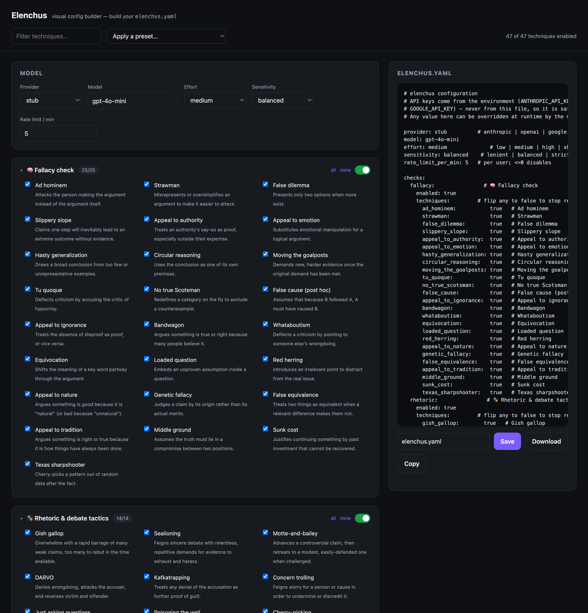

# Elenchus

**Cross-examine text for logical fallacies and manipulation — from the CLI, your browser, an MCP tool, or a Discord/Slack bot, with any LLM.**

📖 **Docs site:** https://quetzaluz.github.io/elenchus/

The *elenchus* (ἔλεγχος) is the Socratic method of probing an argument until its weaknesses show. This is that, as software: paste a message and get back the specific fallacies, rhetorical tactics, framing bias, or scam signals in it — each with the exact quote, a one-line explanation, and a confidence. It judges *how* something is argued, not whether it's "right," so it stays defensible and non-partisan.

- 🧠 **Fallacy detection** — 25 informal fallacies (ad hominem, strawman, false dilemma, sunk cost, …)
- 🎭 **Rhetoric & debate tactics** — 14 bad-faith tactics (Gish gallop, sealioning, motte-and-bailey, DARVO, …)
- 🧭 **Bias & framing** — 10 framing tactics (loaded language, us-vs-them, scapegoating, catastrophizing, …)
- 🚩 **Scam / manipulation detection** — 8 red-flag families (fake urgency, credential requests, impersonation, …)
- 🎛 **57 techniques, each a toggle** — a strict allow-list, so turning one off actually stops it being reported
- 🔌 **Four frontends, one engine** — CLI, [MCP](https://modelcontextprotocol.io) server, Discord, Slack
- 🤖 **Provider-agnostic** — Anthropic, OpenAI, or Google (Gemini); or `stub` to run with no key
- 🧰 **A visual config builder** and a plain YAML file — no code to customize it

---

## The visual config builder (`elenchus web`)

Toggle checks and techniques, filter, apply a preset (Debate / Moderation / …), pick a model, and watch the `elenchus.yaml` build live. Save it and every frontend picks it up.



---

## Quickstart

```bash
pip install -e ".[all]"          # or pick extras: .[openai] / .[anthropic] / .[mcp] / .[discord] / .[slack]

# 1. Try it with zero setup (canned output, no API key):
LLM_PROVIDER=stub elenchus analyze "Everyone knows this is true, so only a fool would disagree."

# 2. Point it at a real model:
export OPENAI_API_KEY=sk-...      # or ANTHROPIC_API_KEY / GOOGLE_API_KEY
LLM_PROVIDER=openai LLM_MODEL=gpt-4o-mini \
  elenchus analyze "You can't trust his study, he's not even a real scientist."
```

```
🧠 Fallacy check
This message contains logical fallacies.

  ▸ Ad hominem  (high)
    "he's not even a real scientist"
    This attacks the person's credibility instead of addressing the validity of their study.
```

## CLI

```bash
elenchus analyze "text to check"          # pretty output (color on a TTY)
elenchus analyze "text" --check rhetoric  # fallacy | rhetoric | bias | scam
elenchus analyze "text" --check all       # run every enabled check at once
elenchus analyze "text" --json            # raw JSON for piping
elenchus analyze --sensitivity strict     # lenient | balanced | strict (per call)
echo "piped text" | elenchus analyze      # reads stdin

elenchus checks                           # list every check + technique and its on/off state
elenchus config                           # show the resolved config (source, model, key, counts)
elenchus init                             # write a fully-commented elenchus.yaml
elenchus web                              # open the visual config builder
elenchus serve                            # localhost API for the Chrome extension
elenchus mcp                              # run the MCP server (stdio)
elenchus discord | slack                  # run a chat bot
```

## What it checks for

All four checks share one output shape (`overall` + a list of `findings`: name, quote, explanation, confidence). Every technique below is individually toggleable in the config.

**Fallacy** (25) — ad hominem · strawman · false dilemma · slippery slope · appeal to authority · appeal to emotion · hasty generalization · circular reasoning · moving the goalposts · tu quoque · no true Scotsman · false cause (post hoc) · appeal to ignorance · bandwagon · whataboutism · equivocation · loaded question · red herring · appeal to nature · genetic fallacy · false equivalence · appeal to tradition · middle ground · sunk cost · Texas sharpshooter

**Rhetoric & debate tactics** (14) — Gish gallop · sealioning · motte-and-bailey · DARVO · kafkatrapping · concern trolling · just asking questions · poisoning the well · cherry-picking · nutpicking · false balance · weasel words · argument by repetition · dog whistle

**Bias & framing** (10) — loaded language · framing effect · anchoring · false precision · survivorship bias · appeal to novelty · scapegoating · us-versus-them · catastrophizing · euphemism/spin

**Scam** (8) — fake urgency · unsolicited prize/money · credential request · impersonation · off-platform contact · too-good-to-be-true offer · guilt/fear pressure · mismatched/lookalike link

Adding a technique is a one-line entry in `elenchus/data/checks/*.yaml`; adding a whole check is one new YAML file. No code change.

## Configuration

Settings resolve **defaults → config file → environment** (env wins). API keys are read **only** from the environment, never from the file — so a config file is safe to commit.

A config file is auto-discovered from `./elenchus.yaml`, `$ELENCHUS_CONFIG`, or `~/.config/elenchus/config.yaml`. Generate one with `elenchus init` (or the web builder):

```yaml
provider: openai          # anthropic | openai | google | stub
model: gpt-4o-mini
effort: medium            # low | medium | high | xhigh | max
sensitivity: balanced     # lenient | balanced | strict
rate_limit_per_min: 5     # per user; <=0 disables

checks:
  fallacy:
    enabled: true
    techniques:
      ad_hominem: true
      appeal_to_nature: false   # e.g. turn one off
  rhetoric:
    enabled: true
  scam:
    enabled: false              # or turn a whole check off
```

| Env var | Purpose |
|---|---|
| `LLM_PROVIDER` / `LLM_MODEL` / `LLM_EFFORT` | Model selection (override the file) |
| `FALLACY_SENSITIVITY` | `lenient` / `balanced` / `strict` |
| `RATE_LIMIT_PER_MIN` | Per-user rate limit |
| `ANTHROPIC_API_KEY` / `OPENAI_API_KEY` / `GOOGLE_API_KEY` | Credentials |
| `ELENCHUS_CONFIG` | Explicit config-file path |

Google (Gemini) runs through Google's OpenAI-compatible endpoint automatically — no extra dependency.

## As an MCP tool

Expose `analyze` and `list_checks` to any MCP client (Claude Desktop, Claude Code, IDEs):

```jsonc
// Claude Desktop → claude_desktop_config.json
{
  "mcpServers": {
    "elenchus": {
      "command": "elenchus",
      "args": ["mcp"],
      "env": { "LLM_PROVIDER": "openai", "LLM_MODEL": "gpt-4o-mini", "OPENAI_API_KEY": "sk-..." }
    }
  }
}
```

```bash
# Claude Code
claude mcp add elenchus --env LLM_PROVIDER=openai --env OPENAI_API_KEY=sk-... -- elenchus mcp
```

## In the browser (Chrome extension)

A personal Chrome extension lives in [`chrome-extension/`](chrome-extension/README.md). Run `elenchus serve` (a localhost-only JSON API over the same engine and config), load the folder unpacked at `chrome://extensions`, and you get:

- **Selection check** — highlight text on any page → ⚖ chip or right-click → results panel
- **As-you-write** — Grammarly-style: watches the field you're typing in, underlines flagged phrases, badge shows the finding count
- **Page scan** — per-page toggle that analyzes the page and keeps watching for new content (works in Discord/forums), underlining flawed reasoning in others' messages; click an underline for the explanation

The server rejects requests from web-page origins, so only the extension (or same-machine tools) can reach your engine.

## As a chat bot

Both bots share the engine, respect the config (model, rate limit, enabled checks), and register **one command + action per check automatically** (a new check needs no bot code), plus DM chat.

- **Discord** (`elenchus discord`) — a `/<check>` slash command and an "Elenchus: <check>" right-click menu per check. Needs `DISCORD_BOT_TOKEN`, the *Message Content Intent*, and (to use it anywhere without a server admin) *User Install* enabled in the Developer Portal.
- **Slack** (`elenchus slack`) — Socket Mode; a `/<check>` command and `check_<check>` message shortcut per check (add each in your Slack app config). Needs `SLACK_BOT_TOKEN` + `SLACK_APP_TOKEN` and the `message.im` event.

## Architecture

```
elenchus/
  data/            ← the "brain": prompts, schema, sensitivity, checks (YAML/JSON) — language-neutral
  core/
    checks.py        load checks + techniques from data/
    prompt.py        assemble the system prompt from ENABLED techniques (strict allow-list)
    providers.py     Anthropic / OpenAI / Google / stub, with typed errors + a degradation ladder
    config.py        defaults ← file ← env; per-check + per-technique toggles
    engine.py        Config → provider + rate limiter + analyze()  ← the one contract
  configio.py      render an elenchus.yaml (shared by `init` and the web builder)
  cli.py           argparse entry point
  frontends/       cli output, mcp_server, web, discord, slack  ← thin adapters over Engine
```

The **`Engine`** is the single contract every frontend depends on: `Engine(config).analyze(text, check, sensitivity) -> {overall, findings}`. Robustness lives in the core — output normalization, typed provider errors mapped to friendly messages, and a request-degradation ladder so OpenAI-compatible backends work even without strict JSON-schema support.

## Development

```bash
pip install -e ".[all,dev]"
pytest -q                 # core + frontend contract tests
LLM_PROVIDER=stub python -m elenchus.tools.ratelimit_demo 3 6   # watch rate limiting, no key
```

CI runs the suite on Python 3.10 and 3.12 with no API key (tests use the stub/fake providers).

## License

MIT © Cyd La Luz
